# DESIGN

Signer is a small cross-platform desktop app for placing a scanned signature and other
annotations on top of a document and exporting the result. This document covers how to
run/test/build it, its architecture, and the rationale behind key design decisions. For a
precise description of current app behavior, see [FUNCTIONAL_SPECIFICATION.md](FUNCTIONAL_SPECIFICATION.md).
For the business history behind each feature, see [REQUIREMENTS.md](REQUIREMENTS.md).

## 1. Commands

**Run from source:**
```bash
python main.py
python main.py -document examples/document.pdf -signature examples/signature.png
```
(Equivalent to the "Run Signer" / "Run Signer (examples)" tasks.)

**Opt-in diagnostics:**
```bash
DEBUG=1 python main.py
```
`DEBUG=1` is the standard diagnostic switch. It enables visual/stdout diagnostics for supported
features, including the Prepare Signature tool's development overlays and diagnostic output.
It does not change startup routing or automatically open any tool. Normal runs leave these
diagnostics disabled.

**Run tests:**
```bash
pytest
```
See [TESTING.md](TESTING.md) for test selection, coverage, troubleshooting, and Ruff static analysis.

**Run via the convenience launchers (repository root):**
```bash
signer.bat        # Windows thin wrapper -> wscript.exe -> hidden VBScript (brief cmd flash, then no console)
./signer.sh       # macOS/Linux (chmod +x once if needed)
signer.vbs        # Windows only – VBScript, fully windowless (no console at all)
```
All three scripts `cd` to the repository root, invoke `main.py` with the project's `.venv` Python,
and forward any arguments (e.g. `-document`, `-signature`). The app itself runs with no visible console
window; launchers may briefly flash a command prompt before closing (`signer.bat`), and `signer.vbs`
is the most reliable zero-console option for Windows.

**Build a single-file executable:**
```bash
python -m PyInstaller --clean --noconfirm signer.spec
```
Produces `dist/signer.exe` (Windows) or `dist/signer` (macOS/Linux). See §6 for target-specific
details and constraints (PyInstaller does not cross-compile). The GitHub Actions workflow in
`.github/workflows/build.yml` builds all three platform artifacts on native runners for pushes to
any branch (which also covers the branches of pull requests) and manual workflow runs. These runs upload the executables as
workflow artifacts; pushes to `main` also publish them to a versioned GitHub release.

**Developer setup:**
```bash
git clone <repository-url> && cd signer
python3 -m venv .venv
source .venv/bin/activate              # macOS/Linux; use .venv\Scripts\activate on Windows
pip install -r requirements.txt
```
Requires Python 3.10+.

## 2. Goal & Scope

Build a cross-platform desktop app (Windows, macOS, Linux) to place a scanned signature
(transparent image) on top of a document and export the result with minimal manual steps,
replacing a previously all-manual GIMP-based workflow. See
[FUNCTIONAL_SPECIFICATION.md](FUNCTIONAL_SPECIFICATION.md) for the full current feature set.

### 2.1 Non-Goals
- Digital certificate signing.
- OCR or general PDF editing beyond image export.
- Freehand drawing annotations.
- Advanced typography (multiple fonts per annotation, rich text) beyond a single font
  family/size per text annotation.

### 2.2 Example Assets (`examples/`)
- `document.odt` — sample OpenDocument Text document; master file, other examples are derived from this
- `document.pdf` — sample one-page input document
- `document.doc` / `document.docx` — sample Word documents
- `document1.pdf` — sample multi-page input document (1st page of the master document)
- `document1.jpg` — sample image document
- `signature.png` — sample signature image
- `signature.xcf` — GIMP source; not directly supported for import

## 3. Architecture

### 3.1 Modules

```mermaid
flowchart TD
    main[main.py] --> app[app.py: main&#40;&#41;, QApplication, startup load]
    app --> cli[cli.py: argparse -document/-signature]
    app --> settings[settings.py: AppSettings, SettingsStore]
    app --> mw[main_window.py: MainWindow]
    mw --> canvas[canvas.py: Canvas]
    mw --> notification[notification.py: toast widget]
    mw --> quality[export_quality_dialog.py]
    mw --> prepsig[prepare_signature_dialog.py]
    prepsig --> sigbg[signature_background.py: background removal, trim, resize]
    prepsig --> debug[debug.py: DEBUG-gated diagnostics]
    canvas --> objects[objects.py: CanvasObject hierarchy]
    canvas --> history[history/: Action, HistoryStack]
    mw --> loader[document_loader.py: DocumentLoaderRegistry]
    loader --> pdf_utils[pdf_utils.py: render_all_pages&#40;&#41;]
    mw --> compositor[compositor.py: composite + export]
```



| Module | Responsibility |
|---|---|
| `app.py` | Entry point: builds `QApplication`, loads settings, constructs `MainWindow`, wires up optional action recording, runs the startup document/signature load |
| `cli.py` | Parses `-document` / `-signature` startup arguments |
| `main_window.py` | Toolbar and hamburger-menu construction, document/project lifecycle (open/save/print/change document), menu/toolbar context-sensitivity |
| `canvas.py` | Page rendering, fit-to-window and zoom/pan transforms, annotation selection/move/resize/drag-drop, keyboard handling, page navigation, rotation, clipboard |
| `objects.py` | `CanvasObject` and `VectorAnnotation` hierarchy: per-type geometry, defaults, rendering, serialization |
| `hand_drawn.py` | Pure, deterministic geometry of the hand-drawn style: wobbly polylines, rectangles, and closed-spline ellipses as `QPainterPath`s, computed in PDF points and scaled to the viewport |
| `compositor.py` | Compositing annotations onto page bitmaps and exporting to JPG/PNG/PDF/TIFF/BMP |
| `document_loader.py` | `DocumentLoaderRegistry`: format detection and per-format loading (PyMuPDF for PDF, LibreOffice conversion for Word/ODT, Pillow for images) |
| `pdf_utils.py` | Thin `render_all_pages()` wrapper delegating to `DocumentLoaderRegistry` |
| `export_quality_dialog.py` | Non-modal "Export Quality Options" panel (JPG/PDF quality slider) |
| `prepare_signature_dialog.py` | "Prepare Signature…" tool (hamburger Tools menu): open scan/PDF page → crop → transparency preview, tuning, sizing, save; standalone from the open document/canvas |
| `signature_background.py` | Pure image-processing functions used by the dialog above: luminance and hue-based background removal, sequential alpha-mask composition, content-bounding-box auto-trim, and aspect-ratio-locked resize to a target point size |
| `debug.py` | Public `debug_print` helper for `DEBUG=1` diagnostics; tags default to the calling module's filename |
| `notification.py` | Toast notification widget (success/error variants) |
| `settings.py` | `AppSettings` dataclass, `SettingsStore` (load/save JSON), portable-vs-installed config resolution |
| `history/action.py` | One `Action` subclass per undoable operation (move, resize, add, delete, color/width/font change, cut/paste, rotate, …) |
| `history/history_stack.py` | `HistoryStack`: undo/redo stacks with move/resize coalescing, scoped to one drag gesture via `end_coalescing()` |

### 3.2 Data model

- Documents are normalized to a `list[PIL.Image]` (one per page) at 300 DPI, regardless of
  source format.
- Each page owns an independent list of `CanvasObject` annotations (`page_index -> objects[]`).
- Every annotation stores its geometry in **document coordinates**, i.e. pixels of the page
  rendered at 300 DPI (`x`, `y`, base width/height, `scale`), plus a normalized clockwise
  `rotation` angle. Sizes and distances are *defined* in PDF points and converted with
  `DPI_SCALE = 300/72` when they are created (a 20pt checkmark is stored as ≈83 px); constants
  whose name ends in `_PT` are points, and a constant such as `KEYBOARD_MOVE_STEP_PT` must be
  multiplied by `DPI_SCALE` before it is added to a document coordinate. Text spacing and font
  size are stored in points and converted when drawing.
- Undo/redo, project-file persistence (`.signer`), and action-recording test fixtures share the
  annotation entity shape (see §4 for why); the serializers are separate pieces of code
  (`to_dict`, `ProjectFile.from_annotations`, the history snapshots), so a new persisted field
  has to be added to each of them.

## 4. Key Design Decisions & Rationale

- **LibreOffice headless conversion for Word/ODT**, rather than a native `.docx`/`.odt` parser:
  reuses the existing PDF rendering pipeline (PyMuPDF) unchanged and gets accurate layout
  fidelity for free, at the cost of an optional external dependency.
- **Sizes defined in PDF points, stored in 300-DPI document coordinates**: user-facing sizes
  (annotation sizes, font size, line width, nudge step) are expressed in points, which is how
  PDF/print measurements are normally expressed, while the stored geometry uses the pixels of
  the 300-DPI render so that drawing, hit-testing and export need no conversion; a single
  `DPI_SCALE` constant converts between the two.
- **Zoom is a canvas-only transform**: `DocumentCanvas` keeps a zoom multiplier and pan offsets
  separate from the document and annotation coordinates. Zoom steps multiply or divide by
  `ZOOM_STEP` (`1.25`), with `1.0` as the fit-to-window floor. Pointer-anchored zoom adjusts
  the pan offsets to keep the document point under the pointer stationary, then clamps the page
  edges to the canvas. If an axis becomes smaller than the canvas, the clamp preserves the side
  where gray space was already visible instead of flipping the margin by recentering. Fit to
  Window and page/document resets explicitly restore zoom `1.0` and zero pan. Export, printing,
  hit testing, and annotation serialization continue to use document coordinates.
- **Rotation composed around annotation centers**: each annotation retains an unrotated local
  bounding box and an intrinsic clockwise angle. Canvas painting, hit-testing, handles, and
  export apply the angle around the center; page rotation is a separate per-document transform
  composed on top, so saving a project never bakes page orientation into annotation geometry.
  Page rotation lives in `DocumentCanvas._page_rotations` and drives a matching rotated entry in
  the `_page_pixmaps` cache; the two are updated together (`set_pages`, `restore_objects`,
  `_rotate_pages`), since a mismatch would draw an unrotated page into a transposed rect.
- **Line/Arrow bounds are derived from rendered vector geometry**: both types keep their square
  storage geometry so endpoint resizing and serialization remain stable, while
  `VectorAnnotation.boundary_points_viewport()` and `contains_viewport_point()` use content
  rectangles. Arrow tightly encloses its shaft, head, and pen radius. Line encloses its stroked
  endpoints and centrally pads each dimension to the shared Arrow-head spread factor
  `ARROW_HEAD_SPREAD_FACTOR`; the constant derives from the same head length and angle used to
  draw Arrow, avoiding a second independent scaling formula.
- **Coalescing is scoped to one drag gesture**: `HistoryStack` merges consecutive move/resize
  actions on the same object, but `DocumentCanvas` calls `end_coalescing()` on mouse release
  (and the stack closes the window on undo/redo/clear). Without that boundary a second drag
  would rewrite the first action's target and one Ctrl+Z would revert both gestures.
- **History actions target the annotation's own page**: undo/redo resolves the page from the
  annotation rather than from `current_page_objects()`, which returns a throwaway `[]` for pages
  with no entry yet and would otherwise discard the annotation if the user navigated away.
  `Action.page_object_list()` is the single place that resolves a page to its mutable list.
- **Page rotation history stores per-page angles**: `RotatePageAction` records the before/after
  angle of every page it touched, rather than one shared angle plus a "-1 means all pages"
  sentinel, so undoing a "rotate all" after a single-page rotation restores each page's own
  orientation instead of flattening them.
- **Failures are reported, not absorbed**: operations that can partially succeed surface that to
  the user — a paste that could not read every clipboard item emits `pasteIncomplete`, and an
  export that lost pages returns failure instead of clearing the unsaved-changes flag.
- **Group rotation as one history operation**: multi-selection rotation uses the center of the
  complete selection boundary, applying one angular delta to positions and intrinsic angles.
  Its per-object state changes are grouped in a `CompositeAction`, preserving exact undo/redo.
- **One shared action/entity model for undo/redo and action recording**: avoids two parallel
  serialization formats. The same `Action` classes and the same annotation JSON shape
  (`CanvasObject.to_dict()`/`from_dict()`) are used by `HistoryStack` (undo/redo) and
  `tests/recording/` (feature-test fixtures) - a fix or extension to one applies to both.
  `.signer` project files (`ProjectFile.from_annotations()`/`load_annotations()` in
  `objects.py`) intentionally use a related but distinct, hand-maintained schema (e.g.
  `"type": "add_annotation"` instead of `"type": "VectorAnnotation"`) rather than calling
  `to_dict()`/`from_dict()` directly, so any field added to the annotation model that must
  survive a project save/reload (e.g. `rotation`, line/arrow `angle`, `natural_width`/
  `natural_height`) has to be added to `ProjectFile.from_annotations()` explicitly too - it
  is not automatic. A prior code review missed this, causing rotation/angle/custom text
  size to be silently reset to their defaults on project reload (fixed 2026-09-23).
- **Text character spacing uses one measured font definition**: `VectorAnnotation._make_font()`
  applies absolute spacing in 300-DPI pixels for both `QFontMetricsF` boundary fitting and Qt
  painting. View painting scales font size and spacing together, keeping the canvas, exported
  image, and selection geometry consistent. Spacing is stored in PDF points and defaults to zero
  when loading older annotation or project data. The line extent used for fitting the box and for
  positioning the text comes from `VectorAnnotation._text_line_extent()`: Qt's bounding rectangle
  ends after the spacing that follows the last character, and with a negative spacing it is too
  narrow or even empty, so that spacing is taken off and, for a negative spacing, the glyph
  outline is taken into account too.
- **Two canvas signals separate "the document changed" from "the view changed"**:
  `DocumentCanvas.objectChanged` means the annotations (or page rotation) changed and marks the
  document as having unsaved changes; `viewChanged` (zoom, fit, page change, selection) refreshes
  the toolbar/menu state only. A new code path that edits annotations must emit `objectChanged`
  (undo/redo actions do), one that only changes what is shown must not.
- **Resize actions record the complete geometry**: a resize can move the annotation, change a
  text's font size and turn a line/arrow, so `ResizeAnnotationAction` stores
  `CanvasObject.geometry_state()` before and after (`from_geometry`/`to_geometry`) and undo/redo
  restore it exactly. Drag actions are recorded after the page-boundary clamping, so they hold the
  state that is shown. Recorded fixtures without geometry still replay through the size-only path.
- **Non-native Save As dialog**: Qt's native file dialogs don't expose their filename `QLineEdit`
  for real-time monitoring. Using a Qt-rendered dialog (`DontUseNativeDialog`) trades the native
  OS look for the ability to auto-correct the filename (page placeholder, extension) as the user
  types.
- **Toasts vs. modal dialogs**: successes are shown as auto-dismissing, non-blocking toasts so
  the user isn't interrupted; anything that needs explicit acknowledgment (errors, failures) is
  either a manually-dismissed toast (brief/non-fatal) or a blocking `QMessageBox` (real
  failures) — never a silent auto-dismiss for something the user must notice.
- **Portable vs. installed config resolution**: checking the application directory for
  `config.json` first (before the platform user-config directory) lets a whole
  executable-plus-config folder be copied/moved as a unit, with no separate "portable mode"
  installer needed.
- **Two sequential extraction methods for "Prepare Signature…"**: luminance removal handles the
  ordinary dark-ink-on-light-paper case, while optional hue filtering can run afterward to remove
  black text/dots around colored ink. Keeping the filters independent makes each method tunable
  and allows either one or both to be selected.
- **Selection toolbar widget actions are restored explicitly**: `QToolBar.addWidget()` hides and
  disables both an embedded widget and its generated `QWidgetAction`. The selection toolbar
  therefore restores both states after each row assignment; restoring only the child widget
  leaves controls invisible after a selection-triggered re-layout.
- **Selection toolbar fitting measures, it doesn't predict**: `_sync_context_toolbar()` inserts
  every candidate control into the row, lays the row out at an oversized width, and reads each
  control's real `x() + width()`. Placement is then the longest prefix whose right edge fits the
  budget. An earlier version summed `sizeHint()` values taken while the controls were parented to
  the plain canvas container, which underestimated their real width by ~12% — the row's stylesheet
  (13px font) only applies once a control is inside the row. That gap let controls overlap the
  overflow button and the window edge, and delayed the overflow button by a resize step. Because
  a toolbar row is laid out left-to-right with fixed spacing, positions of the kept prefix are
  unaffected by removing trailing items, so a single measurement pass is exact.
- **Overlay toolbar rows are created on demand**: overlay mode repeatedly takes the longest
  measured prefix that fits the current width and assigns the remainder to another real
  `QToolBar`, creating rows until every control is placed. Reserve-space mode continues to use
  exactly one row plus the application's overflow popup. Unused overlay rows are collapsed and
  retained for reuse so resizing does not destroy and recreate controls.
- **Selection toolbar rows are positioned with explicit geometry, not layout constraints**: each
  row's size is applied by clearing its previous minimum/maximum and then setting the new
  geometry and fixed size. Mixing a new maximum with the previous mode's stale minimum let Qt
  clamp the row to the old reserved height, leaving a dark strip over the canvas after switching
  to overlay mode.
- **Qt's native toolbar extension is suppressed**: `QToolBar` creates a `qt_toolbar_ext_button`
  ("»") and moves controls behind it on its own. Its popup is empty for widget actions, so the
  app hides and zero-sizes that button and supplies its own `…` button and popup instead.
- **Hand-drawn strokes are a pure function of (seed, local size)**: each
  Checkmark/Crossmark/Line/Arrow/Rectangle/Ellipse stores `hand_drawn: bool` and
  `hand_drawn_seed: int`. When on, `VectorAnnotation._draw_checkmark/_draw_crossmark/_draw_line/
  _draw_arrow/_draw_rectangle/_draw_ellipse` draw a `QPainterPath` from `hand_drawn.py` instead of
  calling `drawLine/drawRect/drawEllipse`. Each straight segment is cut into knots about every
  12pt and every inner knot is moved sideways by a gentle bow plus jitter, then the knots are
  joined with a Catmull-Rom spline (converted to cubic Béziers); segment endpoints get no offset.
  Each stroke uses its own `random.Random` derived from the seed and the stroke index. Lengths
  and deviations are computed in PDF points and multiplied by `unit` (viewport pixels per point,
  `DPI_SCALE` times the zoom) only at the end, so the shape is identical at every zoom, in
  `render_to_pil()` for export/print, and across repaints. A per-paint random call or pixel-based
  spacing would make the wobble shimmer when zooming and differ between screen and export. How
  much it wobbles is described in the next item.
  A Rectangle is four separate wobbly sides that meet at the same corners as the straight rectangle (the stroke centre line, half a pen width in from the box).
  The Ellipse is a single closed periodic spline with no start or end: its outline is divided
  into knots (one per ~14pt of perimeter, at least 8), each pushed along the outward normal by
  noise, and joined with a closed Catmull-Rom spline whose neighbour indices wrap around, so the
  curve is C1-continuous where the knot list begins and ends, leaving no gap, overlap, or end
  cap. Hand-drawn shapes use round joins and caps. The shapes are not inset: a hand-drawn
  Rectangle has its corners exactly where the straight one has them, so toggling the style does
  not move them. The wobble (and the round caps of a line at the box edge) may bulge past the
  bounding box, which is fine because export draws directly onto the page (see "Export draws
  vector annotations directly onto the page" below).
- **Wobbliness is a handful of constants at the top of `hand_drawn.py`**: there is no single
  "wobble factor" and no user setting; the look comes from these values, which can be tuned by
  looking at the reference image of `tests/feature/test_hand_drawn_annotations.py`. All
  distances are in PDF points, so the result does not depend on zoom or output resolution.

  | Constant | Value | Effect |
  |---|---|---|
  | `AMPLITUDE_PER_LENGTH` | 0.012 | Deviation grows by 1.2% of the stroke length, so long strokes wobble more in absolute terms |
  | `AMPLITUDE_PER_LINE_WIDTH` | 0.4 | Deviation grows with line width, so short strokes drawn with a thick pen still read as hand-drawn |
  | `MAX_AMPLITUDE_PER_LENGTH` | 0.04 | Upper limit: the deviation never exceeds 4% of the stroke length, so short strokes stay recognizable |
  | `MAX_AMPLITUDE_PER_SHORT_SIDE` | 0.06 | Same limit for Rectangle/Ellipse relative to the shorter side, so thin shapes do not collapse |
  | `KNOT_SPACING_PT`, `ELLIPSE_KNOT_SPACING_PT` | 12, 14 | Distance between spline knots: smaller means the line changes direction more often (busier wobble) |
  | `BOW_SHARE` | 0.6 | Share of the deviation that is one smooth bend of the whole stroke; the rest is per-knot jitter |
  | `ELLIPSE_HARMONICS`, `ELLIPSE_HARMONIC_SHARE_RANGE` | 1-3, 0.25-0.5 | Ellipse only: the lopsided "egg" irregularity |

  The maximum deviation of one stroke is `deviation_amplitude_pt()` =
  `min(0.012 * length + 0.4 * line width, 0.04 * length)` (additionally capped for Rectangle and
  Ellipse). For example, an 80pt line at the default 1.5pt width deviates by up to
  `0.012 * 80 + 0.4 * 1.5 = 1.56pt` (about 2% of its length; the cap of 3.2pt does not apply),
  while the short (about 8pt) stroke of a default checkmark is held by the cap to about 0.3pt. Where that amplitude is
  spent is decided in `wobbly_knots()` (bow plus jitter along a stroke) and
  `wobbly_ellipse_path()` (radial noise around the outline). To make everything wobblier or
  calmer, scale `AMPLITUDE_PER_LENGTH`, `AMPLITUDE_PER_LINE_WIDTH` and both `MAX_AMPLITUDE_*` caps
  together; changing any constant changes every seed's shape, so the reference image must be
  regenerated.
- **Export draws vector annotations directly onto the page**: a vector annotation can paint
  past its bounding box: the round caps of a straight Line, Checkmark, or Crossmark (their
  endpoints lie on the box edges and a cap sticks out half a pen width), glyphs at the edge of
  a Text box, and the hand-drawn wobble.
  Rendering each annotation into an image of a fixed size and pasting it would cut those parts
  off, and sizing the image generously needs a per-type formula for how far each type reaches. So
  there is no intermediate image: `_composite_objects()` draws every `VectorAnnotation` with
  `VectorAnnotation.draw_for_export()` onto a page-sized transparent `QImage` layer, using the
  same `QPainter` drawing code and the same rotation (`painter.rotate` about the box centre) as
  the canvas, so export equals the screen by construction, and composites the layer over the
  page. A run of consecutive vector annotations shares one layer; the layer is flushed before a
  signature/image, which is resampled and pasted with Pillow, so z-order is kept. An unrotated
  annotation is drawn at its rounded box position, so its pixels do not depend on the fractional
  part of its position. `render_to_pil()` is the box-sized render used for hit-testing only; it
  clips at the box and hides any overflow, so tests that check exported pixels use
  `_composite_objects()` (`export_to_page()` in `tests/utils/test_helpers.py`) instead.
  Print uses the same `_composite_objects()`. The vector path is selected with
  `isinstance(obj, VectorAnnotation)`, not a `hasattr` duck-type, so test doubles do not take it.
- **Hand-drawn style does not affect geometry**: bounding boxes, `contains_viewport_point()`,
  handles, endpoint snapping, and `ARROW_HEAD_SPREAD_FACTOR` padding keep using the ideal
  straight geometry, so selection feels identical whether the style is on or off and no new
  bounds math is needed. Hit-testing against rendered pixels
  (`distance_to_visible_pixel`) naturally sees the wobbly pixels.
- **Hand-drawn is a `PropertyChangeAction`**: a new `ChangeHandDrawnAction` follows
  `ChangeLineWidthAction` (grouped in `CompositeAction` for multi-selection). The seed is set
  once in `VectorAnnotation.__init__` (random) and never changed by the toggle, so toggling off
  and on again restores the same look. `to_dict()`/`from_dict()`, `duplicate()`, and clipboard
  copy carry the seed; `ProjectFile.from_annotations()`/`load_annotations()` must be extended
  explicitly (see the project-schema note above) and write the two fields only when
  `hand_drawn` is true, so older files and unaffected types are unchanged. Missing fields load
  as off. The initial value of a new annotation comes from
  `DocumentCanvas.hand_drawn_default(last_used)`: it follows the annotations already in the
  document (all pages; off if any supporting annotation is not hand-drawn, on if all are) so a
  document stays consistent, e.g. after opening a project, and only falls back to
  `AppSettings.recent_hand_drawn` (default `False`) when the document has none.
  `recent_hand_drawn` is written whenever the user toggles the property, like
  `recent_color`/`recent_line_width_pt`. `MainWindow._add_vector()` is the only caller;
  duplicate and paste copy the source's value.
- **Hand-drawn toggle is a selection-toolbar item**: a checkable `QToolButton` registered with
  `ctx_item()` like the other property controls (so it takes part in `_sync_context_toolbar()`
  fitting and the overlay/reserve-space modes), visible when any selected annotation supports the
  style. It is created after the Angle group on purpose: items overflow from the end, and putting
  it earlier pushed Angle into the overflow popup at the minimum window width. It has no
  hamburger-menu entry, matching color and width.
- **Recent file lists hold absolute paths**: `MainWindow._update_recent_path_list()` (used by
  `_update_recent_documents()`/`_update_recent_signatures()`, so every open path incl. the
  `-document`/`-signature` startup load goes through it) makes the path absolute and drops
  entries that resolve to the same file, then applies the usual LRU update. Relative entries
  already in an existing `config.json` are not rewritten (their base directory is unknown); they
  are replaced when that file is opened again, or pruned when it can't be found.
- **Recent-file labels are computed per list**: `MainWindow._recent_path_labeler(paths)` returns
  the `label_fn` for `_rebuild_menu_items()`/`_rebuild_tracked_menu_section()` for the recent
  documents and recent signatures lists. A label can't be derived from one path alone (whether a
  folder is needed depends on the other entries), hence the per-list closure built on every menu
  rebuild. The folder is the full parent path, not an abbreviated suffix: partial paths proved
  meaningless to the user, and menus simply grow wider.

## 5. Testing Architecture

Tests are split into unit tests (`tests/unit/`) and feature tests (`tests/feature/`, pixel-diffed
against reference images), plus an action-recording system (`tests/recording/`) used to produce
new feature-test fixtures. See [TESTING.md](TESTING.md) for how to run, troubleshoot, and extend
them.

`tests/feature/test_hand_drawn_annotations.py` replays `tests/fixtures/hand_drawn_annotations.json`
(six hand-drawn shapes of each type, with fixed seeds) and compares page 3 with its reference image.
The reference is also meant to be looked at when tuning the wobble parameters in `hand_drawn.py`.

## 6. Distribution / Build Details

PyInstaller does not cross-compile: build each release on the target operating system and CPU
architecture. The checked-in GitHub Actions workflow provides the recommended one-push build:
it uses native Windows, macOS, and Ubuntu runners, runs the platform-stable unit tests on each
runner with `QT_QPA_PLATFORM=offscreen`, and uploads one artifact per platform. A separate step
runs the native toolbar subprocess tests on Windows and macOS. The headless Linux runner skips
native toolbar checks; these remain available locally with an X11 or Wayland session. Hosted
runners skip the full pixel-baseline and window-sizing suites that require a stable display or
font rasterizer; those remain available for local/platform-specific validation. A Linux build is
tied to its architecture and to a compatible glibc baseline;
the workflow therefore uses Ubuntu 22.04 as the supported Linux build baseline.

Create and populate a clean virtual environment on each build machine (see §1 for the commands),
then run the build command from §1. On Windows, activate with `.venv\Scripts\activate` first.

The checked-in `signer.spec` selects the ICO asset on Windows and a PNG asset on macOS/Linux,
embeds `signer/resources`, disables the console window, and creates one file:

| Target | Output | Smoke test |
|---|---|---|
| Windows | `dist/signer.exe` | `dist\signer.exe` |
| macOS | `dist/signer` | `./dist/signer` |
| Linux | `dist/signer` | `./dist/signer` |

The macOS result is a single command-line-launchable GUI executable, not a Finder `.app` bundle
— a signed/notarized `.app` is a directory bundle and therefore a separate distribution format.
Build separately on Intel and Apple Silicon unless creating and testing a universal binary.

Before publishing an artifact, run the full automated suite and the smoke test on the same
target used for the build. For Linux, also test at least one X11 and one Wayland session when
both are supported. LibreOffice remains an external optional dependency for Word/ODT input and
is never bundled.

Every branch push runs the platform-stable unit tests and builds all three executables, uploading
them as workflow artifacts. A push to `main` also attaches them to a GitHub release. The latest
`## Version MAJOR.MINOR` heading in
`REQUIREMENTS.md` supplies the first two version components. The commit introducing that heading
gets patch version `0`; subsequent commits descended from it and reachable from `main` increment
the patch component.
For example, a `1.3` requirement starts at `v1.3.0`, then advances to `v1.3.1`, `v1.3.2`, and so
on. All commits descended from the requirement commit and reachable from `main` count, including
commits merged from other branches and merge commits. A new requirement heading resets the patch
component to `0`. Before publishing, the workflow compares the calculated version with existing
`vMAJOR.MINOR.PATCH` tags and fails rather than publishing a downgrade. The calculation is
implemented in `signer/release_version.py` and covered by unit tests.

Branch pushes (including pull-request branches) and manual workflow runs build and test the executables but retain them only as
workflow artifacts. Code signing and macOS notarization are not configured yet and require
platform-specific credentials and certificates.

On Linux build/CI machines without a display, run the suite headlessly with
`QT_QPA_PLATFORM=offscreen python -m pytest`. Missing Qt system libraries or platform plugins at
run time are distribution-specific packaging issues and should be resolved on the oldest
supported build/test image, not worked around at build time.

Qt's offscreen platform can report no installed font families on headless Windows runners, while
macOS offscreen runs normally retain access to CoreText fonts. CI supplies `QT_QPA_FONTDIR`
with `C:/Windows/Fonts` on Windows, whose offscreen backend uses FreeType rather than native
font discovery. Before testing, a font preflight checks that families are available and that
text metrics are valid. The platform-stable test step disables Python and pytest-qt output
capture so native abort diagnostics are not lost with the test process.
The font-family toolbar therefore
starts with the application's common-font choices before appending families discovered by Qt;
tests explicitly cover the empty-database case and must not rely on host-installed fonts.

PySide6 is pinned to the locally validated `6.11.2` release in `requirements.txt`. CI previously
installed `6.12.0` through the open-ended dependency range; Linux then aborted with a native
`none_dealloc` reference-count error during `QPainter.fillRect` in the signature checkerboard.
The pin prevents unreviewed binding upgrades and is a conservative rollback, pending Linux
verification. Native mode-switch image failures save expected/actual snapshots in the repository
root, uploaded as per-platform CI artifacts. The strict image comparison is retained so a real
layout regression is not hidden by relaxing the check.

**Portable build**: after building, copy the executable from `dist/` to any writable directory;
optionally place a `config.json` next to it to enable portable mode (see
[FUNCTIONAL_SPECIFICATION.md §15](FUNCTIONAL_SPECIFICATION.md#15-persistence--settings) for the
resolution order and edge cases).

